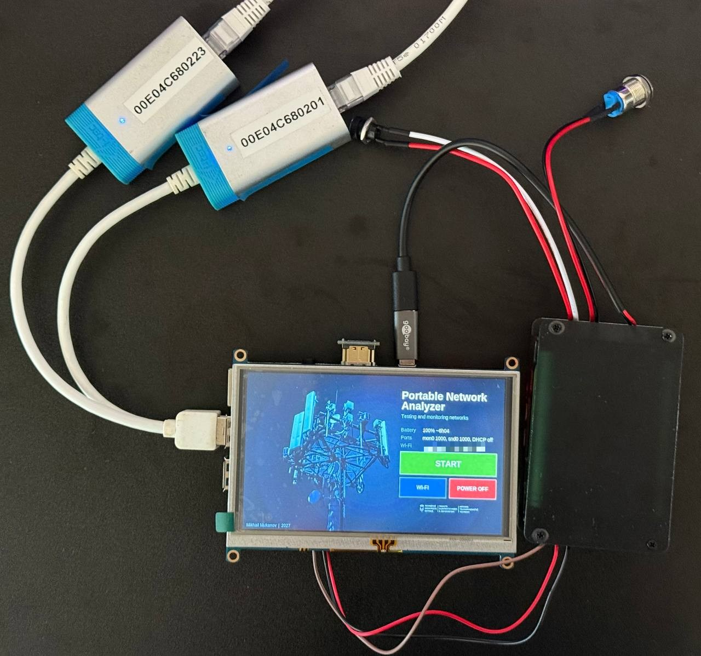
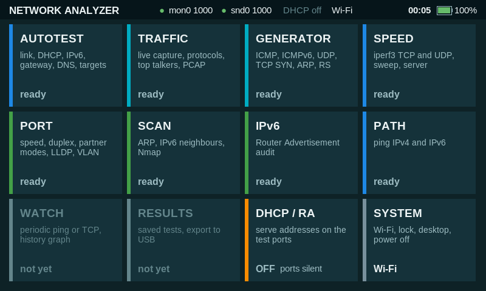
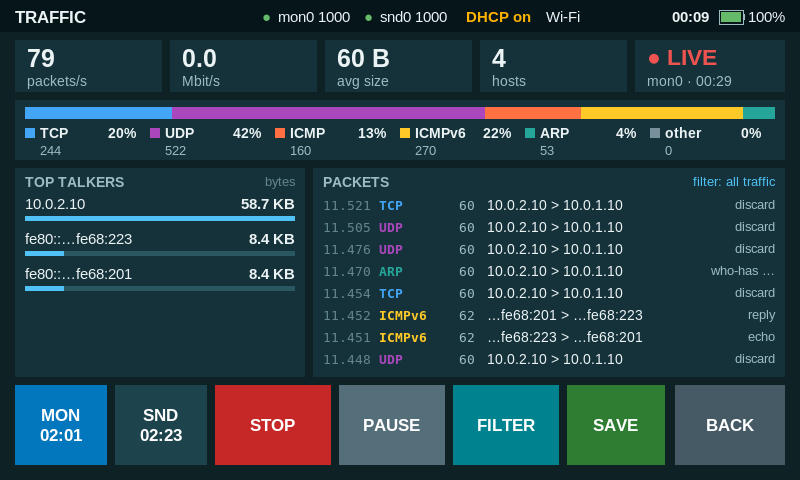
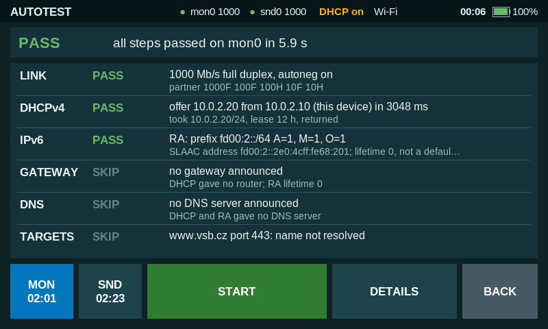
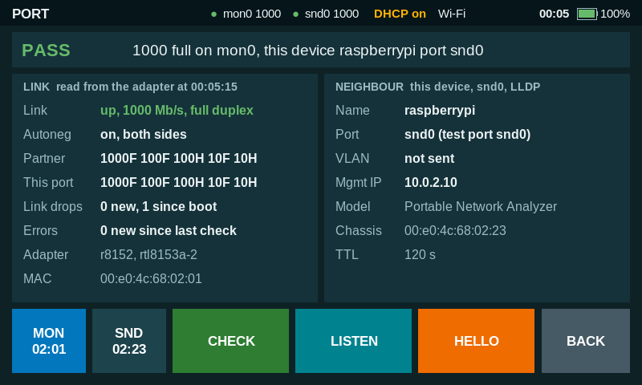
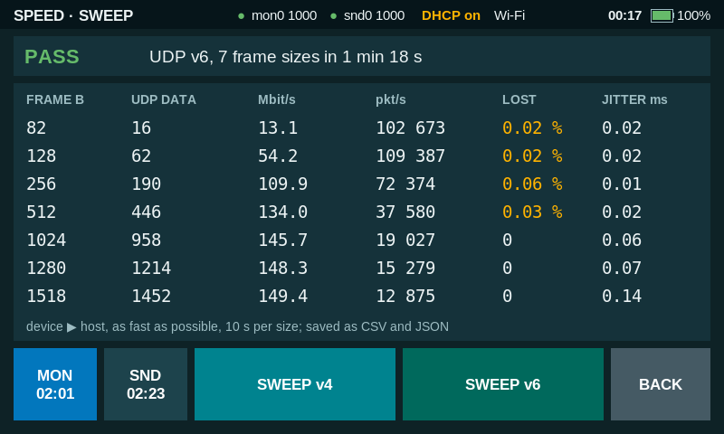
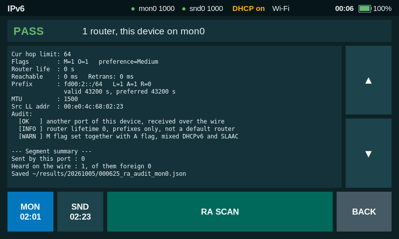
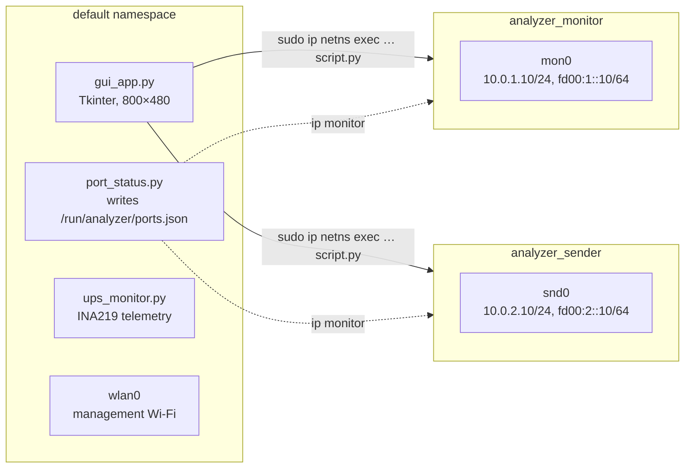

# RPi Network Tester

A portable, battery-powered device for testing and monitoring Ethernet networks,
built on a Raspberry Pi 3 Model B+ with a 5" touchscreen and two USB Gigabit
Ethernet test ports. It boots straight into a touch interface and works without
a keyboard, a laptop or an SSH session.

Bachelor's thesis project at VŠB – Technical University of Ostrava, Faculty of
Electrical Engineering and Computer Science, Department of Telecommunications.
Thesis title: *Přenosné zařízení pro testování a monitorování sítí*
(Portable Device for Testing and Monitoring Networks).

<p align="center">
  
</p>

## Features

| Screen | What it does |
|---|---|
| **AUTOTEST** | One-button check of a network outlet: link, DHCPv4 (a lease is taken for the run and released afterwards), IPv6 Router Advertisement and SLAAC, gateway reachability, DNS, TCP connect to target hosts from a profile |
| **TRAFFIC** | Passive capture with an in-kernel BPF filter: packets/s, bit/s, protocol mix, IPv4/IPv6, host count, top talkers, live packet list; a paused view decodes any packet layer by layer; one button saves PCAP, CSV and a JSON summary |
| **GENERATOR** | Sends ICMP, ICMPv6, UDP, TCP SYN, ARP or Router Solicitation frames at a chosen count, rate and frame size; on a port-to-port loop the second port counts what arrived and reports the loss |
| **SPEED** | iperf3 TCP and UDP over IPv4 and IPv6 in both directions, a frame-size sweep in the style of RFC 2544, and an iperf3 server on the selected port |
| **PORT** | Link diagnostics from the adapter: speed, duplex, autonegotiation, the partner's advertised modes, link drops and error counters; passive LLDP, CDP, STP, LACP and 802.1Q listening; an optional single LLDP frame so that the switch lists the device as a neighbour |
| **SCAN** | ARP scan, IPv6 neighbour discovery with EUI-64 / opaque identifier detection (RFC 7217), Nmap |
| **IPv6** | Router Advertisement audit: flags, prefixes, lifetimes, MTU, RDNSS, DNSSL, with checks against RFC 4861 and RFC 4862 and detection of foreign routers |
| **PATH** | ping over IPv4 and IPv6; tells "host present but ping blocked" from "no host" |
| **DHCP / RA** | Optional dnsmasq on the test ports so that a connected PC gets an address |
| **SYSTEM** | Battery state, Wi-Fi networks chosen and joined from the touchscreen, screen lock, desktop, power off |

Test results are also stored as JSON in `~/results/<date>/` with a timestamp
and the checksum of the script that produced them.

## Screenshots

| | |
|---|---|
|  |  |
| Home screen | Live traffic statistics |
|  |  |
| AutoTest of a network outlet | Link diagnostics and LLDP neighbour |
|  |  |
| UDP frame-size sweep over IPv6 | Router Advertisement audit |

## Architecture

The two test ports are isolated from each other and from the rest of the system
with Linux network namespaces. Each port lives in its own namespace with its own
addresses, routing table and neighbour cache, so a test on one port cannot leak
to the other one or to the management Wi-Fi.



The interface is a thin layer. Every test is a standalone script started as a
subprocess inside the namespace of the chosen port, because `ip netns exec`
changes the namespace of a process, not of a thread. Each script prints progress
lines and finishes with a machine-readable line `RESULT <script> <json>`, so the
same script works from the touchscreen and from a shell:

```bash
sudo ip netns exec analyzer_monitor python3 autotest.py mon0
sudo ip netns exec analyzer_monitor python3 sniff_stats.py mon0 --duration 30 --pcap /tmp/cap.pcap
```

Ports are named by MAC address with systemd `.link` files (`mon0`, `snd0`), so
the order in which the USB adapters are enumerated does not matter. A templated
service puts a port into its namespace whenever the adapter appears, at boot or
when it is plugged in later. Any other USB Ethernet adapter can take a free port.

### Quiet by default

A test device plugged into someone else's network must not disturb it. Nothing
is served on the test ports until the DHCP / RA screen turns it on, and even then
dnsmasq hands out addresses only, with no gateway and no DNS, and Router
Advertisements carry a router lifetime of 0. Kernel Router Solicitations are
disabled on the test ports. LLDP is sent only on an explicit button press. The
packet generator and iperf3 refuse targets outside the test bench unless run with
`--force` (RFC 6815).

## Hardware

| Part | Notes |
|---|---|
| Raspberry Pi 3 Model B+ | Raspberry Pi OS (Debian 13), kernel 6.18 |
| Joy-IT RB-LCD-5, 5" HDMI display | 800×480, resistive touch (XPT2046, `ads7846` driver), uses header pins 1–26 |
| 2× USB Gigabit Ethernet adapter, Realtek RTL8153 | the two test ports |
| Waveshare UPS Module 3S, 3× 18650 cells | 12.6 V pack, boost to 5 V into the Pi's micro-USB |
| INA219 (on the UPS module) | software I²C on GPIO5/GPIO6: `dtoverlay=i2c-gpio,bus=3,i2c_gpio_sda=5,i2c_gpio_scl=6`, address `0x41` |

The built-in Ethernet port and Wi-Fi of the Pi are not test ports; Wi-Fi is used
for management and for Nmap Wi-Fi scans.

## Measured performance

| Quantity | Result |
|---|---|
| TCP throughput to an external host | 274–276 Mbit/s |
| Throughput port to port on a loop cable | ~150 Mbit/s |
| Lossless passive capture | ~22,500 packets/s |
| Packet generator, small frames | up to ~84,000 packets/s |
| Power draw | 3.4 W idle to 6.1 W worst case |
| Battery life, passive capture | 6 h 43 min (2.51 Ah, 28.2 Wh down to the 9.6 V cut-off) |
| Kernel start to touch interface | ~36 s |

The throughput ceiling is a property of the platform, not of the network: on the
Raspberry Pi 3 B+ all USB ports and the Ethernet controller share one USB 2.0
bus (officially up to 300 Mbit/s), and on a port-to-port loop every frame crosses
that bus twice. The packet decoder used by the TRAFFIC screen was checked
against `tshark` on 58 frames: 781 fields, no differences.

## Repository layout

```
src/                     code that runs on the device
  gui_app.py             entry point: welcome / lock screen and the home screen
  ui_kit.py, screens.py  screen template and the smaller screens
  traffic.py, generator.py, speed.py, port.py, autotest_screen.py
                         the larger screens
  autotest.py, sniff_stats.py, pkt_gen.py, perf_test.py, perf_server.py,
  port_info.py, l2_listen.py, ra_audit.py, neigh_scan.py, arp_scan.py,
  path_test.py           test scripts, each usable on its own
  pktdecode.py           frame decoder without Scapy
  targets.py, results.py target discovery, result files
  port_status.py         port watcher service
  ups_monitor.py         battery telemetry and automatic shutdown
  wifi_dialog.py         Wi-Fi window and on-screen keyboard
  setup_network.sh       namespaces, addresses, optional DHCP / RA
  profiles/default.json  AutoTest profile (DNS name, TCP targets)
  assets/                welcome screen background
system/                  systemd units, .link files, NetworkManager drop-in, xinitrc
docs/images/             photo and screenshots
```

## Installation

The project is a device image rather than a Python package. On Raspberry Pi OS
with the desktop and a user with passwordless `sudo`:

```bash
sudo apt install python3-scapy python3-tk python3-smbus tcpdump iperf3 dnsmasq nmap ethtool
```

1. Copy `src/` to `/home/muk0015/diploma_project/`. The path is fixed in
   `gui_app.py`, `port_status.py`, `results.py`, `traffic.py`,
   `autotest_screen.py` and in the unit files; change it there for another user.
2. Put the MAC addresses of your two adapters into
   `system/10-analyzer-mon0.link` and `10-analyzer-snd0.link` and copy both to
   `/etc/systemd/network/`.
3. Copy `system/99-analyzer-ports.conf` to `/etc/NetworkManager/conf.d/` so that
   NetworkManager leaves the test ports alone.
4. Copy the `.service` files to `/etc/systemd/system/` and enable them:
   ```bash
   sudo systemctl enable analyzer-port@mon0 analyzer-port@snd0 analyzer-status ups-monitor
   ```
5. For the appliance mode, enable console autologin, start X from the login
   shell and install `system/xinitrc` as `~/.xinitrc`. The interface then
   replaces the desktop and restarts if it ever exits; the SYSTEM screen can
   still open the desktop.

## Author

Mikhail Mukanov, VŠB – Technical University of Ostrava, 2026–2027.
Supervisor: Ing. Pavel Nevlud.

## License

[MIT](LICENSE)
